  
  



  
  
  

<table>
  <tr>
    <td width="50%"><a href="https://github.com/utkarshpatwa393-sys/jio"></a></td>
    <td width="50%"><a href="https://github.com/utkarshpatwa393-sys/Android-Phone-Seller-Website"></a></td>
  </tr>
  <tr>
    <td width="50%"><a href="https://github.com/utkarshpatwa393-sys/Weather"></a></td>
    <td width="50%"><a href="https://github.com/utkarshpatwa393-sys/snake-"></a></td>
  </tr>
  <tr>
    <td width="50%"><a href="https://my-portfolio-ten-alpha-18.vercel.app/"></a></td>
    <td width="50%"><a href="https://github.com/utkarshpatwa393-sys/mirai_web_beta"></a></td>
  </tr>
</table>




  
  

